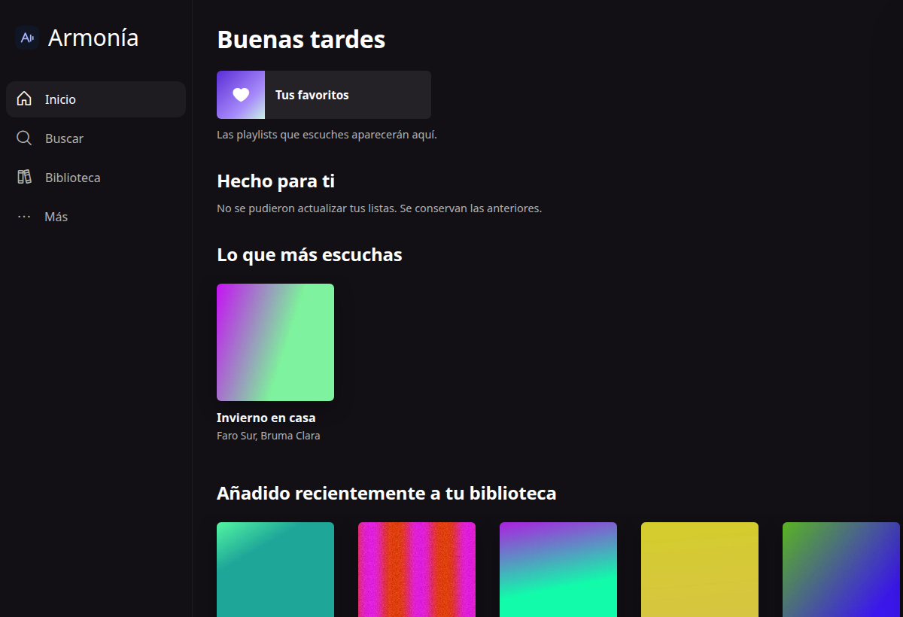

# Armonia

Armonia is a self-hosted music stack with a web app and an Android app (with Android Auto). It puts four
services behind one interface:

- **Navidrome** keeps the accounts and the music libraries.
- **Koito** keeps each user's listening history (one private instance per user).
- **Aurral** suggests music: a weekly list and artist mixes built from what you listen to.
- **Armonia** (this repository) is the server and the interface that brings them together, plus imports
  from Spotify playlists and YouTube.


## What you can do

- Browse your library by artist, album or song, play it and arrange the queue (play next, add to the end,
  reorder, shuffle).
- Import a Spotify playlist from its link or from an Exportify CSV/ZIP. Review the matches and pick between
  recordings when there are several versions.
- Search YouTube and YouTube Music, listen without saving, or save authorized recordings into your library.
- Get a weekly list and artist mixes from your listening history, and keep the music going with similar songs
  when a queue ends.
- On Android: offline downloads, a song cache that fills on Wi-Fi with what you play most, data saving on mobile
  networks, and playback from Android Auto.

The interface is in Spanish for now ([#17](https://github.com/davalonie/armonia/issues/17) tracks the English one).



## How it fits together

```text
 Web browser ─┐                        ┌─ Navidrome   accounts, libraries, playlists (Subsonic API)
              ├─ HTTPS ─ Armonia ──────┼─ Koito ×N    listening history, one private instance per user
 Android app ─┘   (server + web UI)    ├─ Aurral      recommendations (weekly flow, similar artists)
                                       └─ YouTube, Spotify, Last.fm (optional, via yt-dlp and a metadata proxy)
```

Only Armonia is published; the other services live on internal Docker networks. See
[Architecture](docs/architecture.md).

## Quick start

On Linux with Docker Engine and Compose, from the root of this repository:

```sh
cp -n .env.example .env
python3 scripts/prepare.py                       # creates the missing secrets, keeps existing ones
docker compose up --build -d --wait
python3.12 -m venv .venv && .venv/bin/python -m pip install -c middleware/requirements.lock httpx
.venv/bin/python scripts/bootstrap.py --project armonia-stack --users alice bob
```

Open `http://localhost:8000` and sign in with one of the generated accounts (their passwords are in
`secrets/bootstrap-users.json`). The full guide, with Last.fm metadata, a third user and older installs, is in
[Installation](docs/installation.md).

The Android app is built with `python3 tools/android/build_android.py` and installed with
`adb install -r`. See [Android app](docs/android.md).

## Documentation

| Guide | What it covers |
| --- | --- |
| [Architecture](docs/architecture.md) | Services, networks, accounts and where each request goes |
| [Installation](docs/installation.md) | Full stack, optional metadata, older installs and an external Navidrome |
| [Access and files](docs/access.md) | Per-user libraries, deleting files, ports and backups |
| [Authentik sign-in](docs/authentik.md) | Optional single sign-on with Authentik (OIDC) |
| [Android app](docs/android.md) | How the app is built, signing, installing, Android Auto |
| [Playback and cache](docs/playback-and-cache.md) | Streaming, light and data-saving copies, server and phone caches, downloads |
| [Library](docs/library.md) | When a song is saved into Navidrome and when it is not |
| [Recommendations](docs/recommendations.md) | Listening history, weekly list, mixes and similar songs |
| [Development](docs/development.md) | Environment, lab, tests and CI |
| [Tools](docs/tools.md) | Every script in `scripts/` and `tools/` |

## YouTube and SoundCloud

Download only content whose download the service allows and for which you hold the rights or permission. See
the [YouTube terms of service](https://www.youtube.com/static?template=terms). YouTube features are off until the
administrator enables them with `MUSIC_YOUTUBE_CAPABILITIES` (see [Library](docs/library.md)).

SoundCloud is not a source: its API terms do not allow copying tracks into a library, downloading them to a
phone or caching them ([terms](https://developers.soundcloud.com/docs/api/terms-of-use#caching-and-downloading)).

## Credits

Armonia is a derivative work of Kobser, by Stefan Muri and contributors, distributed under GPL-3.0. Armonia's
changes started in November 2026. [Original project](https://github.com/stefan-muri/kobser).

CSV import accepts Spotify playlists exported with [Exportify](https://github.com/watsonbox/exportify), by
watsonbox.

## License

Armonia is distributed under GPL-3.0. [License text](LICENSE).
