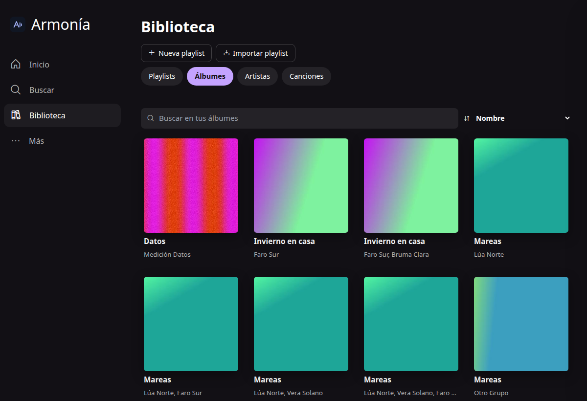

# Armonía

Armonía es un stack de música autoalojado con una aplicación web y una aplicación Android compatible con Android Auto. Navidrome gestiona las cuentas y bibliotecas, Koito conserva las escuchas de cada usuario y Aurral proporciona las recomendaciones. El servidor de Armonía reúne esas funciones en una sola interfaz.



## Qué puedes hacer

- Explorar la biblioteca por artista, álbum o canción, reproducir música y ordenar la cola.
- Importar una playlist de Spotify desde su enlace o desde un CSV. Puedes revisar las coincidencias y elegir entre grabaciones cuando hay varias versiones.
- Buscar en YouTube y YouTube Music e incorporar grabaciones autorizadas a la biblioteca. Cada usuario trabaja con la carpeta de música que tiene asignada en Navidrome.
- Escuchar en Android, gestionar las descargas y usar los controles de reproducción desde Android Auto.


## Instalar el stack de Armonía

Para una instalación nueva en Linux con Docker Engine y Compose, ejecuta los pasos desde la raíz de este repositorio. El [Compose principal](docker-compose.yml) arranca el servidor con la web, Navidrome, Aurral y dos instancias privadas de Koito. Solo se publica Armonía, por defecto en `127.0.0.1:8000`.

**1. Prepara los directorios y las credenciales de esta instalación.** Usa la cuenta de Linux que será propietaria de los datos. Si su UID o GID difiere de 1000, ajusta `MUSIC_UID` y `MUSIC_GID` en `.env` a los valores de `id -u` e `id -g`. El preparador crea los secretos que falten y conserva los existentes.

```sh
cp -n .env.example .env
python3 scripts/prepare.py
```

**2. Elige si Aurral podrá consultar artistas similares en Last.fm.** Para habilitarlo, registra una aplicación en [Last.fm](https://www.last.fm/api/account/create), guarda su **API key** en `secrets/lastfm-api.key` y activa el [Compose de metadatos](compose.metadata.yaml). La clave se introduce sin mostrarla en la terminal. El tráfico de metadatos de Aurral pasa por el servidor de Armonía.

```sh
python3 -c 'from getpass import getpass; from pathlib import Path; Path("secrets/lastfm-api.key").write_text(getpass("API key de Last.fm: ").strip()+"\n")'
```

Añade `COMPOSE_FILE=docker-compose.yml:compose.metadata.yaml` a `.env` para conservar esta selección en los siguientes arranques. Puedes omitir este paso si quieres empezar solo con biblioteca e historial. Para tres cuentas, añade también `COMPOSE_PROFILES=third-user` a `.env` antes del arranque.

**3. Construye y arranca los servicios.**

```sh
docker compose config --quiet
docker compose up --build -d --wait
```

**4. Crea y vincula las cuentas.** Desde el host Linux, usa Python 3.12 con `httpx`. Si ya preparaste el entorno de desarrollo, basta el último comando. Cambia `alice bob` por uno o dos nombres de tu elección, o tres con el perfil anterior. Conserva el orden si repites el aprovisionamiento.

```sh
python3.12 -m venv .venv
.venv/bin/python -m pip install -c middleware/requirements.lock httpx
.venv/bin/python scripts/bootstrap.py --project armonia-stack --users alice bob
```

Las contraseñas generadas quedan en el archivo privado `secrets/bootstrap-users.json`. Entra en `http://localhost:8000` con tu cuenta y vincula Aurral desde **Ajustes → Recomendaciones** con las mismas credenciales. Para el móvil, configura un proxy HTTPS y fija `MUSIC_PUBLIC_ORIGIN` al origen correspondiente. Los datos persistentes quedan en `runtime/`; respalda también `secrets/` y tu configuración local.

### Instalaciones anteriores y Navidrome externo

El [Compose mínimo](compose.minimo.yaml) conserva la configuración anterior. Si ya tienes datos con ese Compose, sigue usándolo en el mismo directorio y con el mismo nombre de proyecto. Para probar el stack completo en paralelo, usa otro clon y otro `MUSIC_PORT` para mantener separados los datos y los secretos. Si Docker indica `all predefined address pools have been fully subnetted`, asigna subredes libres a las redes del proyecto de prueba mediante un Compose local adicional.

- Con el Navidrome que incluía el perfil `full`: `docker compose -f compose.minimo.yaml --profile full up --build -d`. Navidrome escucha en `localhost:4533` y Armonía en `localhost:8000`.
- Con un Navidrome externo: configura `NAVIDROME_URL` y la carpeta compartida `MUSIC_DIR` en `.env` y ejecuta `docker compose -f compose.minimo.yaml up --build -d`.

Las asignaciones de biblioteca y los permisos de borrado se describen en la [guía de acceso](docs/ACCESO.md).

## Compilar e instalar Android

Prepara el entorno, proporciona la clave de firma mediante las variables documentadas y ejecuta el compilador desde la raíz. Al terminar, el script indica el directorio de salida. Instala la APK de release con `adb install -r RUTA_A_LA_APK`. Al abrir Armonía, introduce la URL HTTPS de tu servidor.

```sh
tools/preparar-entorno.sh
python3 tools/android/build_android.py
```

Las versiones del SDK, los pasos de firma y las pruebas del servidor, web y Android están en la [guía del entorno](docs/ENTORNO.md).

## Descargas de YouTube

Descarga únicamente contenido cuya descarga esté autorizada por el servicio y para el que tengas los derechos o permisos correspondientes. Consulta las [condiciones de uso de YouTube](https://www.youtube.com/static?template=terms).

## Créditos

Armonía es una obra derivada de Kobser, de Stefan Muri y colaboradores, distribuida bajo GPL-3.0. Las modificaciones de Armonía comenzaron en noviembre de 2026. [Proyecto original](https://github.com/stefan-muri/kobser).

La importación desde CSV admite las listas de Spotify exportadas con Exportify, de watsonbox. [Exportify](https://github.com/watsonbox/exportify).

## Licencia

Armonía se distribuye bajo GPL-3.0. [Texto de la licencia](LICENSE).
